# GTÜ kampüsünde PM₂.₅: sorunlu zamanlar ve yerler, kişisel maruziyet ve iç/dış ortam senaryoları

**Hazırlayan:** GTÜ AirLab · **Tarih:** 13 Ekim 2026 · **Sürüm:** 1.0
**Veri dönemi:** PurpleAir 1 Mayıs – 12 Ekim 2026 (Türkiye saati; 13 Ekim 00:00'da kesildi); saha oturumları 27–30 Nisan 2026;
Atmotube canlı kayıtları 15 Haziran – 12 Ekim 2026; iç ortam CO₂ 22 Haziran – 21 Temmuz 2026
**Sayıların kaydı:** her sayı `sayilar.json`'da değer, birim, hesap tarifi ve kaynak sorgusuyla yer alır (anahtarlar metinde köşeli
parantezle verilmiştir, ör. [B.ort_mayis_eylul]). Şekiller ve sayılar `betikler/` ile yeniden üretilir (Ek A).

---

## Özet

Kampüsün sabit sensörü (PurpleAir, SUMER çatısı; US EPA düzeltmeli) 1 Mayıs – 12 Ekim 2026 arasındaki 154 tam günde ortalama
12,7 µg/m³ PM₂.₅ ölçmüştür (Mayıs–Eylül: 148 tam gün, 12,1 µg/m³). **Ne zaman:** kirlilik gece ve sabah saatlerinde birikmekte,
günlük döngü 06:00'da en yüksek (ortalama 16,5 µg/m³), 18:00'de en düşük (9,4 µg/m³) değerine ulaşmaktadır; en kötü %5 saatin
%54,8'i 03:00–09:59 arasına, yalnızca %7,4'ü 14:00–19:59 arasına düşmektedir. Dönemin en belirgin olayı 8–12 Ekim epizodudur
(günlük ortalamalar 33,3–41,8 µg/m³; saatlerin %50,4'ü HKİ "Hassas" aralığında ya da üstünde; en yüksek saat 11 Ekim 22:00, 82,3 µg/m³).
**Nerede:** saha verisi kampüsün küçük bir bölümünü kapsamaktadır; 4.008 noktanın %87,8'i tek bir binaya (Kimya ve Çevre Mühendisliği
Bölümü) düşmektedir. Bu kapsam içinde göreli indeksin en yüksek olduğu yer Güzide Kafe çevresidir (G = 1,89; %95 GA 1,43–2,57);
ancak çatı sensörüne oranla (K = 0,96) burada solunan havanın dış ortam düzeyinde olduğu, Kimya binası içinde ise bu düzeyin yaklaşık
üçte iki kadarı olduğu (K = 0,65) görülmektedir. **Kişisel maruziyet:** 12 saha oturumunun zaman ağırlıklı ortalaması 4,1–19,1 µg/m³
(ham Atmotube), çatı sensörüne oranı 0,53–1,74'tür; çoğunlukla bina içinde geçen ve dış ortamın ≥ 6 µg/m³ olduğu oturumlarda oran
0,53–0,88'dir. Kişisel tepe değerler kısa süreli olarak yüksektir (tek kayıt 522, 15 dk 87,6, 60 dk 53,1 µg/m³). **En kötü durum:**
çatı sensöründe günün en kötü 60 dakikası günler arasında ortanca 20,1 µg/m³ (%95'lik 44,4; en yüksek 83,7), kampüs saatlerinde
(08–18) ortanca 16,1 µg/m³'tür (en yüksek 58,2); günlerin %70,8'inde günün en kötü saati kampüs saatleri dışındadır. **Senaryolar:**
tipik bir hafta içi günde (5 Mayıs) 7 saat kapalı pencereli iç ortam ve 1 saat açık havada yürüme varsayımıyla zaman ağırlıklı
ortalama 7,0 µg/m³, aynı sürenin tamamı dış ortamda geçseydi 12,3 µg/m³ olurdu (1,75 kat); solunan miktar 32,4 µg yerine 43,0 µg
olurdu (1,33 kat). Açık havadaki tek saat, gerçekçi senaryodaki solunan miktarın %67'sini oluşturmaktadır; bu saatin sabah 06–09
yerine akşamüstü 16–19 arasına alınması tipik günde yaklaşık %40 daha az PM₂.₅ solunması anlamına gelmektedir. **İç ortam CO₂**
verisi 22 Haziran 15:01'den sonra donmuş değerlerden oluştuğu için (kayıtların %99,4'ü 400 ppm, sabit sıcaklık ve nemle) iç ortam
göstergesi olarak kullanılamamıştır.

---

## 1 Giriş

GTÜ AirLab platformu kampüs hava kalitesini bir sabit sensörle (PurpleAir PA-II, SUMER çatısı), kişisel ölçerlerle (Atmotube PRO)
ve iç ortam CO₂ sensörüyle izlemektedir. Bu rapor kullanıcının dört sorusunu yanıtlamayı amaçlar:

1. Kampüste sorunlu alanlar: nerede, nasıl ve ne zaman kötü?
2. Kişisel maruziyete göre bir sensörün gün içindeki en kötü durumdaki maruziyeti ne kadar?
3. Kampüste geçirilen zaman tamamen dış ortamda geçseydi maruziyet nasıl olurdu?
4. Bunların grafik ve görsellerle, akademik dille çözümlenmesi.

Analizde uygulamanın yöntemleri değiştirilmeden kullanılmıştır: PurpleAir için US EPA düzeltmesi ve A/B kanal denetimi
(`colorscale.js` → `paCorrect`), Türkiye saati, tam gün kuralı (≥ 18 saat), Ulusal Hava Kalitesi İndeksi (HKİ, değer 0,1 µg/m³'e
kesilerek) ve kişisel maruziyet modeli C = P̄ × R × F, D = C × IR × t (`docs/maruziyet_yontemi.md`). Farklı bir yöntemin gerektiği
yerlerde (göreli indeksler, küme bootstrap) gerekçe ve kaynak ayrıca verilmiştir. Kısa süreli ölçümler WHO 24 saatlik kılavuz
değeriyle karşılaştırılmamış, Tuzla istasyonu yöntem kararlarının dayanağı yapılmamıştır.

## 2 Veri ve yöntem

### 2.1 Veri envanteri

**Tablo 1.** Veri kaynakları ve hangi soruyu ne ölçüde yanıtlayabildikleri.

| Veri | Dönem | Hacim | Yanıtladığı soru | Başlıca sınırlılık |
|---|---|---|---|---|
| PurpleAir PA-II, SUMER çatısı (2 dk; US EPA düzeltmeli) | 1 Mayıs – 12 Ekim 2026 | 111.578 iki dakikalık kayıt; 3.751 geçerli saat; 165 takvim gününün 154'ü tam gün [A.pa_kayit_2dk, A.pa_saat, A.pa_tam_gun] | Ne zaman (1), en kötü durum (2), senaryolar (3) | Tek nokta ve çatı yüksekliği; 4–8 Temmuz ve 2–6 Ekim kesintileri; arşiv döneminde sıcaklık ve PM₁₀ büyük ölçüde yok |
| Saha oturumları, Atmotube PRO (1–2 dk, GPS'li) | 27–30 Nisan 2026 | 12 oturum, 4.015 nokta, 3 ekip (her ekip 4 oturum) [A.saha_oturum, A.saha_nokta] | Nerede (1), ölçülen kişisel maruziyet (2) | Dört bahar günü; noktaların %87,8'i tek binada; cihaz kimliği ve kalibrasyonu belirsiz |
| Atmotube canlı kayıtları (ATP-1…5) | 15 Haziran – 12 Ekim 2026 | 416 kayıt, 30 gün; PM₂.₅'li ve kampüs içi 299; PurpleAir'le eşleşen 233 [A.atp_kayit, D.atp_kampus, D.atp_esli] | Kişisel / dış ortam oranı (3) | Seyrek, telefonla eşitlenen anlık değerler; ortam (iç/dış) bilinmiyor |
| İç ortam CO₂ (tek cihaz) | 22 Haziran – 21 Temmuz 2026 | 2.814 kayıt; yalnızca 16'sı değişken [G.co2_kayit, G.co2_degisken_kayit] | İç ortam göstergesi | 22 Haziran 15:01'den sonra donmuş değer (§3.6) |
| Bina poligonları (`campus.geojson`) | — | 96 bina poligonu | Mekânsal eşleştirme | 20 bina adsız ya da genel adlı |

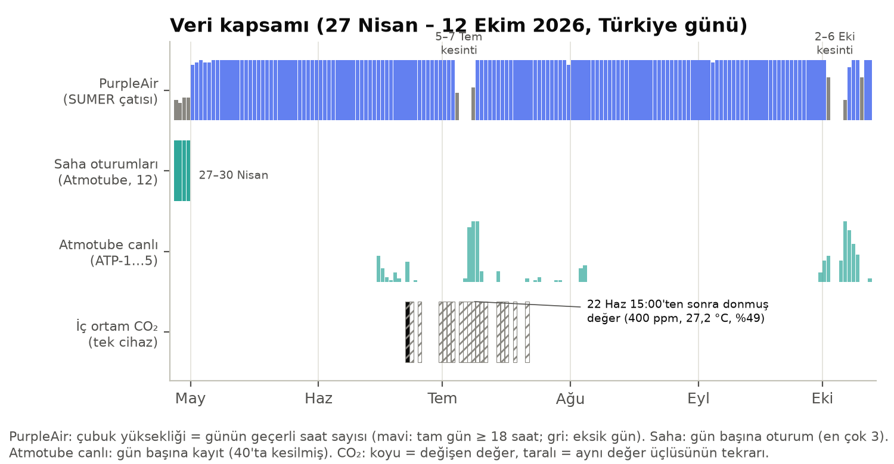

**Şekil 1.** Veri kapsamı (27 Nisan – 12 Ekim 2026, Türkiye günü). PurpleAir satırında çubuk yüksekliği günün geçerli saat
sayısıdır (mavi: tam gün). Saha satırı gün başına oturum sayısını, Atmotube canlı satırı gün başına kayıt sayısını (40'ta
kesilmiş), CO₂ satırı değişen (koyu) ve tekrarlanan (taralı) kayıtları gösterir. Kaynak: Q1, Q2, Q3 (Ek A).

### 2.2 PurpleAir verisinin işlenmesi

Saatlik değerler sunucunun `interval=hourly` sorgusuyla aynı biçimde (saat ortalaması, iki ondalık) Supabase'den alınmış (Q1),
her saatlik satıra uygulamadaki düzeltme uygulanmıştır: cf_1 kanalları varsa 0,524 × cf_1 − 0,0862 × RH + 5,75 (≥ 0), yoksa
genişletilmiş denklem; A ve B kanalları hem ≥ 5 µg/m³ hem ≥ %70 ayrışırsa saat dışarıda bırakılmıştır (Barkjohn vd., 2021).
Analiz dönemindeki saatlerin tamamı asıl yöntemle (cf_1) düzeltilmiş, 5 saat kanal kuralıyla dışarıda kalmıştır
[A.cf1_payi, B.saat_kanal_disi]. Python karşılığı uygulamanın JavaScript kodu ile 418 örnek saatte birebir aynı sonucu vermiştir
(en büyük fark 0). Gün sınırı Türkiye saatidir; tam gün ≥ 18 geçerli saattir. 27–30 Nisan'daki eski biçimli veritabanı kayıtları
(33 saat) zamansal analize alınmamış, yalnızca saha oturumlarıyla eşleştirmede sensörün kendi arşivinden (cf_1 dahil) okunmuştur.
HKİ sınıfları 24 saatlik ortalamalar için tanımlıdır; saatlik ya da kısa pencere değerlerine uygulandığında gösterge niteliğindedir.

### 2.3 Zamansal çözümleme

Saat × haftanın günü düzeninde her hücrenin **ortancası** (bölüm 3.1; tek bir epizodun hücreleri domine etmemesi için), aylara göre
saatlik ortalama ve çeyrekler arası aralık, dönemin 95. yüzdeliğini aşan saatlerin ("en kötü %5") saat, gün ve aya dağılımı
(oran = gruptaki saatlerin en kötü %5'e giren payı) hesaplanmıştır. Günlük döngü ve en kötü %5 hesapları tam olmayan günlerin geçerli saatlerini de içerir; yalnızca tam günlerle sonuçlar çok az değişir (döngü 06:00'da 16,4 ve 18:00'de 9,4 µg/m³; eşik 27,1 µg/m³, 185 saat, sabah payı %55,1; bağımsız denetim). Epizotlar günlük ortalaması 20 µg/m³'ü aşan tam günler olarak
listelenmiştir. Nemle ilişki Spearman sıra korelasyonuyla üç düzeyde incelenmiştir: tüm saatler, gün içi sapmalar (günlük
ortalamadan) ve ay × saat ortancasından sapmalar (ortak günlük döngünün etkisini ayırmak için).

### 2.4 Mekânsal çözümleme

Saha noktaları kampüs sınırı kuralıyla (merkez 40,8114 K, 29,3563 D; 2 km; `backend/kampus.py`) denetlenmiş, bina poligonlarına
uygulamanın kuralıyla (içinde ya da sınırına ≤ 15 m) eşlenmiştir. Saha cihazları kısa süreli ve farklı günlerde ölçtüğünden mutlak
değerler yerine üç oran kullanılmıştır:

- **G** = noktanın PM₂.₅'i / kendi oturumunun ortancası (ana göreli indeks; gün ve cihaz düzeyi farkını giderir).
- **G_PA** = (PM₂.₅ / aynı saatin PurpleAir ham ortalaması) / oturumdaki bu oranın ortancası (oturum içindeki saatten saate
  arka plan değişimini de giderir; duyarlılık denetimi).
- **K** = Atmotube PM₂.₅ (ham) / aynı anın (±3 dk) düzeltilmiş PurpleAir değeri (kişisel / çatı oranı). Atmotube PRO'nun saatlik
  PM₂.₅'te referans cihazla iyi uyum gösterdiği bildirildiğinden (Shittu vd., 2025) düzeltilmiş PurpleAir ile oranlanmıştır; yan
  yana ölçüm tamamlanmadığı için mutlak düzeyi belirsizdir (§5).

Birimler 25 m ızgara hücresi ve binadır; yalnızca en az 2 oturum ve 10 nokta içeren birimler raporlanmış ve haritalanmıştır
(tekil yürüyüş izi gösterilmez). Güven aralıkları oturum düzeyinde küme bootstrap ile (birimin oturumları yerine konarak yeniden
örneklenir, havuzlanmış ortanca hesaplanır; 2000 yineleme, %2,5–97,5 yüzdelikleri) verilmiştir (Field ve Welsh, 2007). Sıcak nokta
ölçütü bu çalışmanın kuralıdır: G ≥ 1,25, ≥ 2 oturum ve ≥ 10 nokta.

### 2.5 Kişisel maruziyet (ölçülen)

Her kayıt oturumun örnekleme aralığını (1 ya da 2 dk) temsil eder; zaman ağırlıklı ortalama (TWA) kayıtların ortalamasıdır.
Kayan ortalamalar (t − 15 dk, t] ve (t − 60 dk, t] pencereleriyle, pencerenin en az %75'i doluysa hesaplanmıştır. Solunan miktar
D = TWA × IR × süre ile, görev tanımındaki tempolu yürüme solunum hızı (1,56 m³/sa) ve alt sınır olarak oturma (0,25 m³/sa;
U.S. EPA, 2011) ile verilmiştir. Kişisel/çatı oranı K_TWA = TWA / aynı kayıt anlarındaki düzeltilmiş PurpleAir ortalamasıdır;
aynı IR ve sürede bu oran, kişinin soluduğu miktarın çatı düzeyinde solunacak miktara oranına eşittir. En yüksek %10 kaydın payı,
kayıtlar büyükten küçüğe sıralanarak en yüksek %10'un Σc içindeki payıdır. Atmotube canlı kayıtları için düzeltilmiş PurpleAir
değeri SQL'de kaydın ±8 dk çevresinde (en az 4 kayıt) ortalanmıştır. Ani yükselmeler ayıklanmamıştır (ekip kararı, 8 Ekim 2026).

### 2.6 En kötü durum

Sabit sensörün 2 dakikalık kayıtlarına düzeltme SQL'de uygulanmış, 15 ve 60 dakikalık kayan ortalamalar pencere fonksiyonlarıyla
hesaplanmış ve yalnızca günlük en yüksek değerler çekilmiştir (Q3). Pencere (t − 15 dk, t] için en az 6, (t − 60 dk, t] için en
az 23 kayıt içermeli ve tamamen aynı Türkiye günü içinde kalmalıdır. "Kampüs saatleri" pencerenin 08:00–18:00 arasında kalmasıdır.
SQL sonuçları depodaki sensör arşivinden (CSV) bağımsız olarak yeniden hesaplanmış, 152 günde fark en çok 0,03 µg/m³ bulunmuştur. Pencereler gün sınırında kesildiği için gece yarısına uzanan bir olay iki güne bölünebilir (ör. 8 Ekim'in tepesi 23:58'de, 9 Ekim'inki 00:44'te biter) ve gece yarısını geçen pencereler hesaba girmez. A/B kanal denetimi saatlik hesaplarda saat ortalamalarına, kayan pencerelerde 2 dakikalık kayıtlara uygulanmıştır.

### 2.7 Senaryolar

Model uygulamadaki gibidir: her satır için C = P̄ × R × F, D = C × IR × t, TWA = Σ(C·t)/Σt; R = 1 (kampüs geneli). P̄ o günün
düzeltilmiş saatlik değerlerinden dakika ağırlıklı alınmıştır (`maruziyet.js` → `pOver`). **Gerçekçi senaryo** uygulamanın
varsayılan satırlarıdır: 09:00–12:00 ve 13:00–17:00 iç ortam, kapalı pencere (F = 0,5), oturma (IR = 0,25 m³/sa); 12:00–13:00
açık hava (F = 1), tempolu yürüme (IR = 1,56 m³/sa). Bu düzen, insanların zamanlarının büyük kısmını kapalı mekânlarda
geçirdiğini gösteren zaman-etkinlik bulgularıyla uyumludur (Klepeis vd., 2001). **Tamamen dış ortam** senaryosunda aynı saatler ve
etkinlikler F = 1 ile hesaplanmıştır. Günler: 1 Mayıs – 12 Ekim arasındaki hafta içi tam günlerden 06:00–19:00 saatlerinin hepsi
ölçülmüş olanlar (107 gün) [F.gun]; tipik gün, günler 09–17 dış ortam ortalamasına göre sıralandığında ortadaki gündür. Duyarlılık
için F'nin belgedeki aralıkları (kapalı pencere 0,3–0,75; mekanik 0,25; açık pencere 0,8), bu çalışmada ölçülen K (Kimya binası
0,65) ve IR'nin 95. yüzdelikleri (0,39 ve 2,28 m³/sa; U.S. EPA, 2011) kullanılmıştır. Açık hava saatinin etkisi için 06:00–09:00
ve 16:00–19:00 pencere ortalamaları gün gün karşılaştırılmıştır.

### 2.8 İç ortam (CO₂)

Planlanan çözümleme saatlere göre dağılım ve 1000 ppm üstü süre payıydı. CO₂ bir kirletici değil havalandırma göstergesidir;
ASHRAE standartları bir CO₂ sınırı içermez ve yaklaşık 1000–1200 ppm düzeyi esas olarak insan kaynaklı koku kabulüyle ilişkilidir
(ASHRAE, 2022). Analizden önce kayıtların ölçüm niteliği denetlenmiş (aynı değer üçlüsünün tekrarı), sonuç §3.6'da verilmiştir.

---

## 3 Bulgular

### 3.1 Ne zaman kötü?

**Genel düzey.** 1 Mayıs – 12 Ekim'deki 154 tam günün ortalaması 12,7 µg/m³, Mayıs–Eylül'deki 148 tam günün ortalaması
12,1 µg/m³'tür; günlük ortalaması 15 µg/m³'ü aşan gün sayısı sırasıyla 42 ve 38'dir [B.ort_tum, B.ort_mayis_eylul, B.asim_tum,
B.asim_mayis_eylul]. Aylık değerler Tablo 2'dedir.

**Tablo 2.** Aylık özet (tam günlerin günlük ortalamalarının ortalaması).

| Ay | Tam gün | Ortalama (µg/m³) | Günlük ort. > 15 µg/m³ (gün) | Saatlik profilin en yüksek saati (µg/m³) |
|---|---|---|---|---|
| Mayıs | 31 | 13,4 | 12 | 07:00 (18,8) |
| Haziran | 30 | 12,1 | 9 | 05:00 (16,4) |
| Temmuz | 26 | 11,2 | 3 | 06:00 (15,8) |
| Ağustos | 31 | 13,9 | 12 | 06:00 (17,0) |
| Eylül | 30 | 9,8 | 2 | 07:00 (13,4) |
| Ekim (1–12) | 6 | 27,7 | 4 | 22:00 (35,7) |

**Günlük döngü.** Mayıs–Eylül saatlik ortalaması 06:00'da en yüksek (15,8 µg/m³), 18:00'de en düşük (8,9 µg/m³) değerdedir;
Ekim dahil tüm dönemde aynı saatler 16,5 ve 9,4 µg/m³'tür [B.dongu_mayis_eylul_enb, B.dongu_mayis_eylul_enk, B.dongu_tum_enb,
B.dongu_tum_enk]. Saat × gün ortancaları 7,2 µg/m³ (Cumartesi 13:00) ile 17,9 µg/m³ (Salı 05:00) arasındadır (Şekil 2). Desen her
ayda benzerdir: Mayıs–Eylül'de tepe 05:00–07:00 arasında, en düşük değerler 16:00–19:00 arasındadır (Şekil 3). Ekim bu açıdan
farklıdır: düzey bütün gün yüksektir ve en yüksek ortalama gece (22:00, 35,7 µg/m³) görülmüştür; bu, epizodun bölgesel ve çok
günlük karakteriyle uyumludur. Tam günlerin %58,4'ünde günün en yüksek saatlik değeri 00:00–09:59 arasında, %25,3'ünde 06:00 ya da
07:00 saatinde ölçülmüştür [B.gunluk_tepe_00_09_payi, B.gunluk_tepe_06_07_payi].

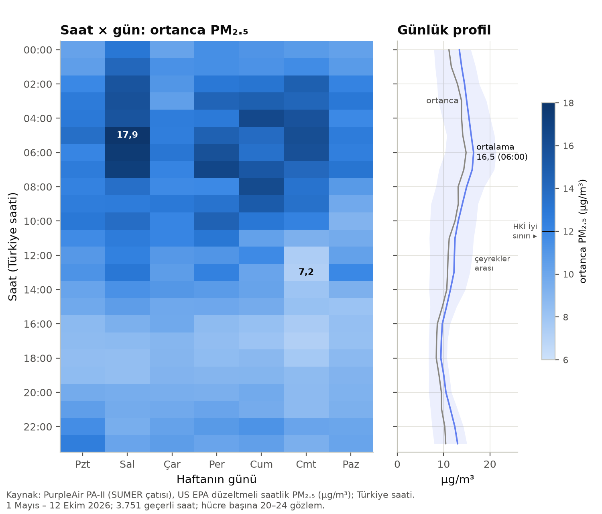

**Şekil 2.** Saat × haftanın günü ortanca PM₂.₅ (µg/m³) ve sağda günlük profil (mavi: ortalama, gri: ortanca, bant: çeyrekler
arası). Kaynak: PurpleAir PA-II (SUMER çatısı), US EPA düzeltmeli saatlik değerler; 1 Mayıs – 12 Ekim 2026; Türkiye saati;
3.751 saat, hücre başına 20–24 gözlem.

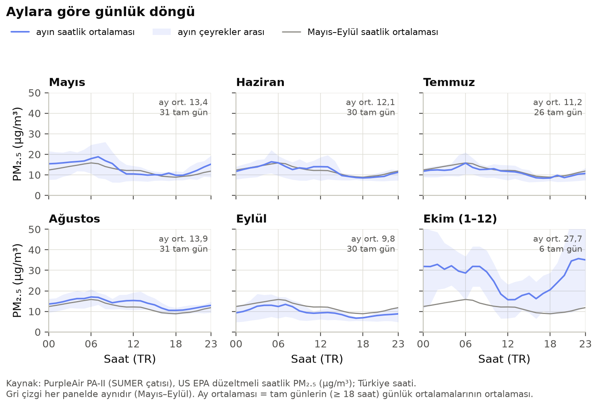

**Şekil 3.** Aylara göre günlük döngü: ayın saatlik ortalaması (mavi), çeyrekler arası aralığı (bant) ve her panelde aynı olan
Mayıs–Eylül ortalaması (gri). Kaynak ve birim Şekil 2 ile aynı; Ekim 1–12 Ekim'i kapsar.

**Hafta içi ve hafta sonu.** Gündüz (10:00–16:00) saatlerinin ortancası hafta içi 11,2, hafta sonu 9,2 µg/m³'tür; sabah
(06:00–10:00) ise iki grup birbirine yakındır (14,0 ve 13,4 µg/m³) [B.gunduz_hafta_ici_medyan, B.gunduz_hafta_sonu_medyan,
B.sabah_hafta_ici_medyan, B.sabah_hafta_sonu_medyan]. Sabah tepesinin hafta sonu da sürmesi, bu tepenin yalnızca kampüs içi
etkinlikle değil, gece boyunca biriken kirliliğin sığ sınır tabakasında tutulmasıyla da ilişkili olabileceğini düşündürmektedir
(Seinfeld ve Pandis, 2016); gündüzkü hafta içi fazlası ise trafik ve kampüs etkinliğinin katkısıyla uyumludur.

**En kötü %5 saat.** Dönemin 95. yüzdeliği 27,5 µg/m³'tür (188 saat). Bu saatlerin %54,8'i 03:00–09:59, %7,4'ü 14:00–19:59
arasındadır; bir saatin en kötü %5'e girme oranı en çok 07:00'de (%11,5) görülür [B.p95_esik, B.p95_saat_sayisi, B.p95_03_09_payi,
B.p95_14_19_payi, B.p95_saat_orani_enb]. En kötü saatlerin %44,1'i Ekim'in ilk 12 gününe, %25,0'ı Mayıs'a düşmektedir
[B.p95_ekim_payi, B.p95_mayis_payi]. Ekim dışarıda bırakıldığında (Mayıs–Eylül eşiği 24,8 µg/m³) sabah payı %59,2'ye çıkar; yani
sabah örüntüsü Ekim epizodunun bir ürünü değildir [B.p95_03_09_payi_mayis_eylul]. Haftanın günleri arasında belirgin bir sıralama
yoktur (Şekil 4b).

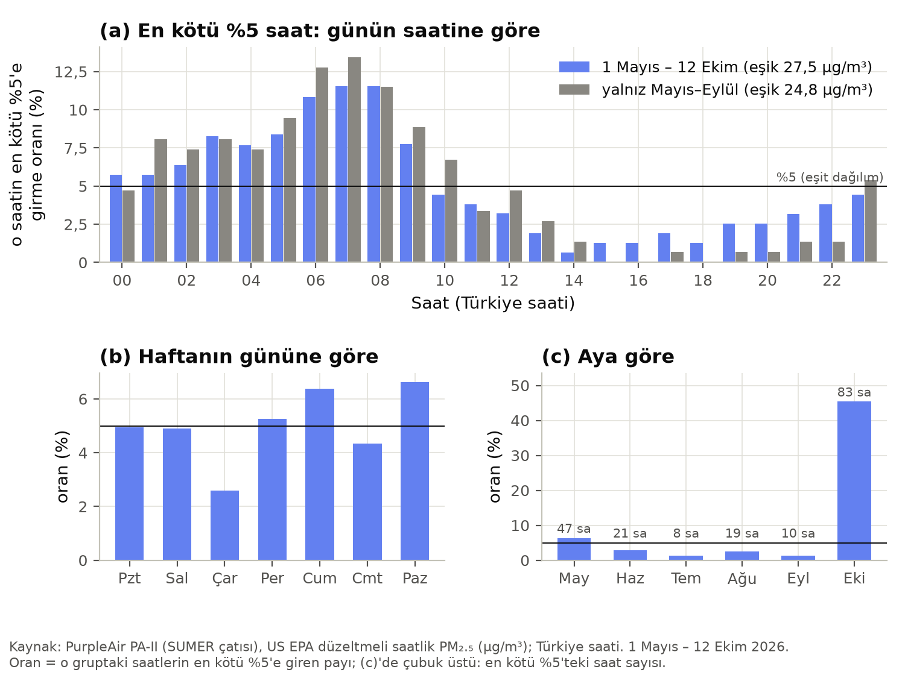

**Şekil 4.** En kötü %5 saatin (a) günün saatine, (b) haftanın gününe ve (c) aya göre dağılımı. Oran, gruptaki saatlerin en kötü
%5'e giren payıdır (eşit dağılımda %5). Kaynak: PurpleAir, US EPA düzeltmeli saatlik PM₂.₅; 1 Mayıs – 12 Ekim 2026; Türkiye saati.

**HKİ sınıflarına göre saatler (gösterge).** Geçerli saatlerin %58,2'si "İyi", %39,7'si "Orta", %1,8'i "Hassas", %0,3'ü
"Sağlıksız" aralığındadır; 35,5 µg/m³ ve üstündeki 78 saatin 57'si Ekim'dedir [B.saat_hki_*, B.saat_hassas_ustu,
B.saat_hassas_ustu_ekim].

**Epizotlar.** 8–12 Ekim'in günlük ortalamaları 33,3 / 33,6 / 39,3 (17 saat) / 41,8 / 37,4 µg/m³'tür; bu 113 saatin ortalaması
36,9 µg/m³, saatlerin %50,4'ü 35,5 µg/m³ ve üstünde, 9 saati 55,5 µg/m³ ve üstündedir; en yüksek saat 11 Ekim 22:00'dir
(82,3 µg/m³) [B.epizot_*]. Analiz 13 Ekim 00:00'da kesildiği için epizodun sonu bu rapora girmemiştir. Daha kısa olaylar: günlük
ortalaması 20 µg/m³'ü aşan diğer tam günler 7 Mayıs (26,2), 8 Mayıs (21,8), 10 Mayıs (20,6), 19 Mayıs (20,2), 7 Haziran (20,8),
26 Ağustos (23,4) ve 21 Eylül'dür (20,6) [B.yuksek_gunler_20].

**Nem ve sıcaklık.** Saatlik PM₂.₅ ile nem arasındaki sıra korelasyonu zayıftır (ρ = 0,23); gün içi sapmalar arasında orta
düzeydedir (0,42), ancak ay × saat ortancasından sapmalar arasında 0,11'e, günlük ortalamalar arasında 0,04'e iner [B.nem_spearman_*].
Nem de gece yükselip (en yüksek 05:00, %61) akşamüstü düştüğünden (en düşük 17:00, %30) ilişkinin büyük kısmı ortak günlük döngüden
kaynaklanmaktadır (Şekil 5c). Optik sensörlerin parçacıklara bağlı su nedeniyle fazla okuması özellikle %75'in üstünde belirgindir
(Jayaratne vd., 2018); bu dönemde saatlik nem yalnızca 5 saatte %75'i aşmıştır [B.nem_75_ustu_saat]. Bu nedenle sabah tepesinin bir
nem ölçüm yapıtı olmadığı düşünülmektedir. Sıcaklık, PurpleAir arşivinde bulunmadığı için yalnızca yaklaşık 365 saatte mevcuttur;
8–12 Ekim'de gövde içi sıcaklık 15,6–34,5 °C arasındadır (ortamdan yaklaşık 4 °C yüksek okur) ve ayrı bir sıcaklık çözümlemesi
yapılmamıştır.

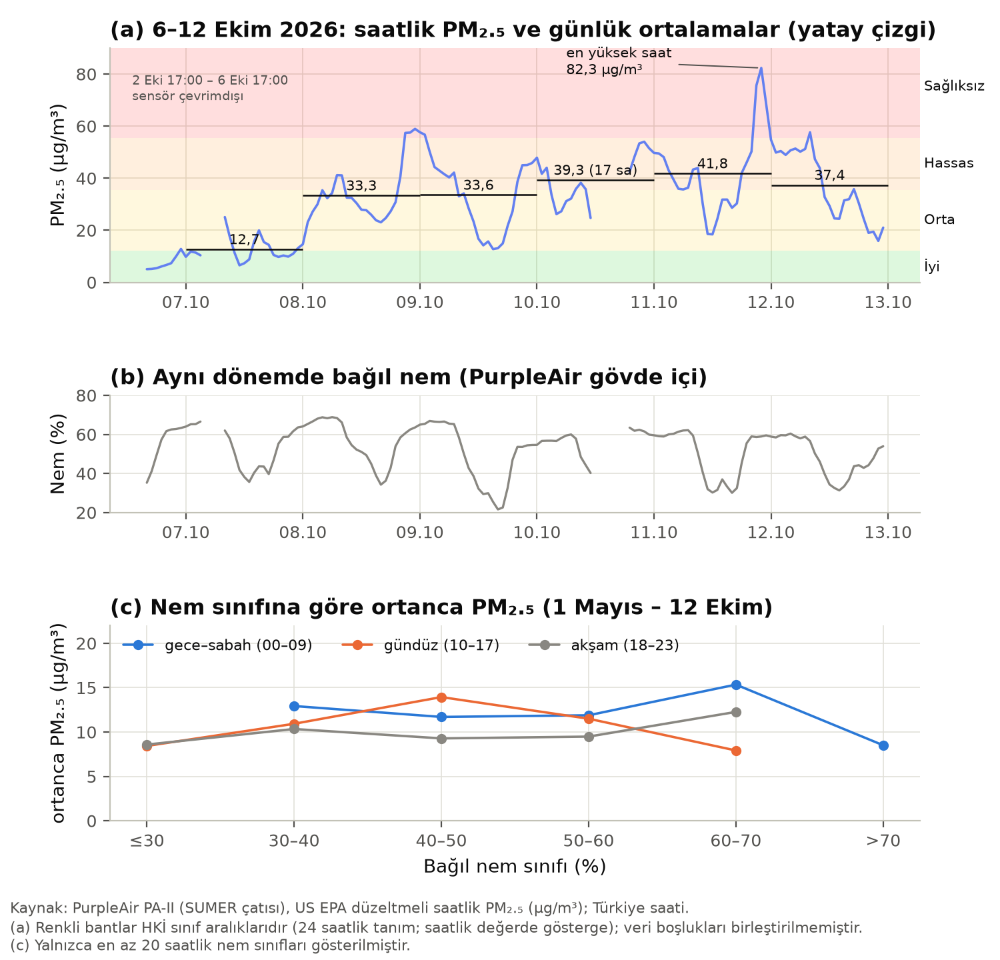

**Şekil 5.** (a) 6–12 Ekim 2026 saatlik PM₂.₅ ve günlük ortalamalar (yatay çizgiler; zemin: HKİ aralıkları); (b) aynı dönemde
PurpleAir gövde içi bağıl nem (%); (c) 1 Mayıs – 12 Ekim'de nem sınıfına ve gün dilimine göre ortanca PM₂.₅ (µg/m³; en az 20
saatlik sınıflar). Kaynak: PurpleAir, US EPA düzeltmeli saatlik değerler; Türkiye saati.

### 3.2 Nerede kötü?

**Kapsam.** 12 oturumun 4.015 noktasının tamamı kampüs sınırı içindedir; PM₂.₅ değeri olan 4.008 noktanın %87,8'i Kimya ve
Çevre Mühendisliği Bölümü binasına (15 m kuralıyla) düşmekte, 8 oturumda noktaların %85'inden fazlası bu binadadır
[C.nokta_tum, C.kimya_payi, C.kimya_oturum_85]. Oturumların dönme yarıçapı ortancası 46 m'dir (31–378 m) [C.donme_yaricapi_*];
yani oturumların çoğu bir yürüyüş güzergâhından çok, tek bir binada ve çevresinde geçen çalışma günlerini yansıtmaktadır. Bu
nedenle konumu bina içine düşen ölçümlerin önemli bir kısmının iç ortamda alındığı değerlendirilmektedir. En az 2 oturum ve 10
nokta ölçütünü 26 hücre (25 m; 3.786 nokta) ve 4 bina karşılamaktadır [C.hucre_uygun, C.bina_uygun]; ölçüm, kampüsün güneydoğusundaki
Kimya binası – SUMER – Güzide Kafe – Kütüphane hattıyla sınırlıdır (Şekil 6a). Atmotube değerlerinin %95,3'ü tam sayıdır
(1 µg/m³ çözünürlük); 3–6 µg/m³ düzeyinde bu, %15–30'luk adımlar demektir ve G'nin birçok hücrede tam 1,00 çıkmasının nedenidir
[C.atmotube_cozunurluk_tamsayi_payi].

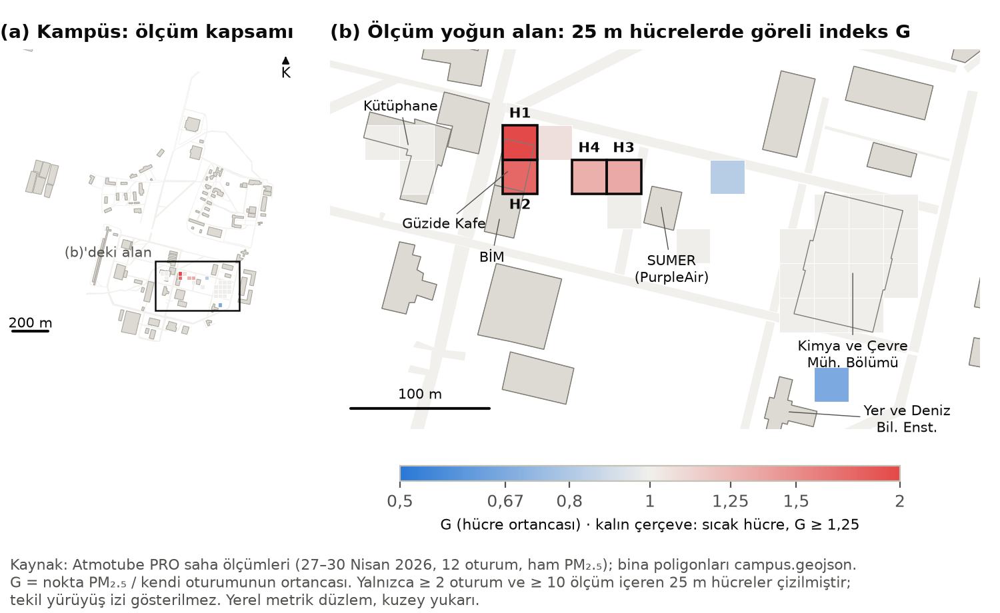

**Şekil 6.** (a) Kampüs bina poligonları ve ölçüm kapsamı; (b) ölçümün yoğun olduğu alanda 25 m hücrelerin göreli indeksi G
(hücre ortancası; mavi: oturum ortancasının altı, kırmızı: üstü; kalın çerçeve: sıcak hücre H1–H4). Kaynak: Atmotube PRO saha
ölçümleri (27–30 Nisan 2026, 12 oturum, ham PM₂.₅) ve `campus.geojson`; yalnızca ≥ 2 oturum ve ≥ 10 ölçüm içeren hücreler.

**Tablo 3.** Bina ve sıcak hücre düzeyinde göreli indeksler (ortanca; GA: oturum düzeyinde bootstrap %95 güven aralığı).

| Birim | Nokta | Oturum | G (GA) | G_PA | K |
|---|---|---|---|---|---|
| Güzide Kafe (bina) | 110 | 6 | **1,89** (1,43–2,57) | 1,07 | 0,96 |
| Kütüphane (bina) | 92 | 3 | 1,00 (0,82–2,50) | 1,33 | 0,69 |
| Kimya ve Çevre Müh. Bölümü (bina) | 3.518 | 12 | 1,00 (1,00–1,00) | 1,00 | 0,65 |
| SUMER (bina) | 29 | 7 | 1,00 (0,90–1,00) | 1,03 | 0,82 |
| Bina dışı (yol, açık alan) | 184 | 8 | 1,10 (0,82–1,46) | 1,28 | 0,95 |
| H1: Güzide Kafe | 36 | 4 | **2,10** (1,92–4,42) | 1,36 | **1,36** |
| H2: Güzide Kafe | 55 | 4 | **1,75** (1,23–3,97) | 1,00 | 0,90 |
| H3: SUMER yakını (21 m) | 12 | 4 | 1,35 (0,82–1,38) | 1,54 | 1,03 |
| H4: Güzide Kafe yakını (44 m) | 21 | 7 | 1,31 (0,88–2,23) | 1,33 | 0,94 |

Kaynak: [C.bina_*, C.bina_disi_ozet, C.sicak_H1–H4].

**Sıcak noktalar.** G ölçütüne göre dört sıcak hücre vardır; ikisi Güzide Kafe poligonunun içinde, ikisi Güzide Kafe ile SUMER
arasındaki yürüyüş hattındadır (Şekil 6b). Güven aralığının alt sınırı 1,25'in üstünde kalan tek birimler H1 ve Güzide Kafe
binasıdır; H2 sınırda, H3 ve H4 belirsizdir. Saatlik arka plan değişimi giderildiğinde (G_PA) dört hücreden üçü 1,25'in üstünde
kalır; G ile G_PA sıralamaları orta düzeyde uyumludur (Spearman ρ = 0,47) [C.sicak_GPA_de_sicak, C.G_GPA_spearman].

**Yorum: göreli indeks neyi gösteriyor?** Oturum ortancaları çoğunlukla Kimya binası içindeki ölçümlerden oluştuğu için G, bir
yerin "dış ortamda kirli" olmasından çok, kişinin olağan (büyük olasılıkla iç ortam) düzeyinin üstüne çıktığı yerleri gösterir.
Çatı sensörüne oran (K) bu ayrımı yapmaya yardım eder: Güzide Kafe'de K = 0,96, bina dışı noktalarda 0,95'tir, yani buralarda
solunan hava çatıdaki dış ortam düzeyindedir; Kimya binasında ise K = 0,65'tir [C.K_kimya, C.K_kimya_disi]. Dolayısıyla Güzide
Kafe çevresindeki yüksek G büyük ölçüde iç–dış ortam farkını yansıtmaktadır. Yalnızca H1'de K = 1,36'dır; bu, o hücrede çatı
düzeyinin belirgin üstünde, yerel bir kaynağın (ör. kafe mutfağı, giriş önünde sigara içimi, araç) varlığını düşündürmektedir,
ancak 4 oturum ve 36 noktaya dayandığından doğrulanması gerekir [C.sicak_K_1_25].

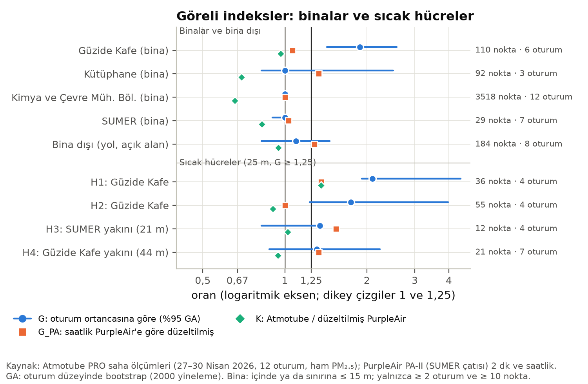

**Şekil 7.** Bina ve sıcak hücrelerde üç göreli indeks (logaritmik eksen): G ve %95 GA (mavi), G_PA (turuncu), K (yeşil).
Dikey çizgiler 1 ve sıcak nokta eşiği 1,25. Kaynak: Atmotube PRO saha ölçümleri (27–30 Nisan 2026) ve PurpleAir PA-II
(2 dk ve saatlik).

**Saha saatleri.** Sabah (08–11), öğle (11–14) ve akşamüstü (14–18) dilimlerinde G ortancası 0,88, 1,10 ve 1,00; K ortancası
0,63, 0,66 ve 0,68'dir [C.bant_*]. Kişisel/çatı oranı gün içinde kararlıdır; G'deki farklar daha çok öğle saatlerinde bina
dışına çıkılmasıyla ve o saatlerdeki daha yüksek dış ortam düzeyiyle (çatıda ortanca 12,9 µg/m³) uyumludur.

### 3.3 Kişisel maruziyet (ölçülen)

**Tablo 4.** Saha oturumlarının özeti (Atmotube PRO, ham PM₂.₅; PurpleAir: aynı anların US EPA düzeltmeli değeri).

| Oturum | Tarih | Saat (TR) | Süre (sa) | Kimya binası (%) | TWA (µg/m³) | PurpleAir (µg/m³) | K_TWA | En yüksek kayıt | En yüksek 15 dk | En yüksek 60 dk | En yüksek %10'un payı (%) | D, yürüme / oturma (µg) |
|---|---|---|---|---|---|---|---|---|---|---|---|---|
| 1 | 27.04 | 08:08–15:13 | 5,7 | 95,9 | 4,1 | 3,9 | 1,06 | 37 | 13,3 | 5,9 | 21,9 | 36,6 / 5,9 |
| 2 | 27.04 | 09:51–17:48 | 8,0 | 100 | 4,2 | 4,2 | 1,00 | 326 | 28,0 | 8,5 | 37,4 | 51,9 / 8,3 |
| 3 | 27.04 | 10:42–16:18 | 2,9 | 15,8 | 4,8 | 4,2 | 1,15 | 28 | 9,8 | 7,0 | 26,9 | 21,8 / 3,5 |
| 4 | 28.04 | 08:51–18:22 | 9,5 | 100 | 5,3 | 8,1 | 0,66 | 209 | 37,1 | 12,4 | 29,2 | 79,5 / 12,7 |
| 5 | 28.04 | 09:00–17:00 | 4,7 | 4,2 | 11,8 | 6,8 | 1,74 | 522 | 87,6 | 31,7 | 62,3 | 86,7 / 13,9 |
| 6 | 28.04 | 09:31–15:03 | 5,6 | 92,2 | 7,2 | 10,2 | 0,70 | 22 | 13,1 | 10,8 | 16,8 | 62,0 / 9,9 |
| 7 | 29.04 | 09:00–17:00 | 8,0 | 68,5 | 9,8 | 15,5 | 0,64 | 34,6 | 16,8 | 14,6 | 17,7 | 123,0 / 19,7 |
| 8 | 29.04 | 09:31–18:08 | 8,3 | 100 | 10,1 | 15,4 | 0,65 | 320 | 47,3 | 16,5 | 29,7 | 130,2 / 20,9 |
| 9 | 29.04 | 09:50–16:39 | 6,8 | 96,8 | 8,8 | 16,5 | 0,53 | 18 | 14,2 | 13,8 | 16,2 | 94,0 / 15,1 |
| 10 | 30.04 | 09:17–17:01 | 7,8 | 46,4 | 19,1 | 17,7 | 1,08 | 63 | 57,6 | 53,1 | 30,8 | 231,0 / 37,0 |
| 11 | 30.04 | 09:40–12:35 | 2,9 | 85,8 | 9,7 | 16,5 | 0,59 | 41 | 23,1 | 15,8 | 30,1 | 44,5 / 7,1 |
| 12 | 30.04 | 10:01–18:16 | 8,3 | 100 | 14,0 | 15,9 | 0,88 | 127 | 39,8 | 30,8 | 26,5 | 180,1 / 28,9 |

Kaynak: [D.oturum_01 … D.oturum_12]. Süre = kayıt × örnekleme aralığı (oturuma göre 1 ya da 2 dk); "en yüksek kayıt"
1 ya da 2 dakikalık tek değerdir (µg/m³).

**Düzey.** 12 oturum toplam 78,5 saattir; TWA 4,1–19,1 µg/m³, K_TWA 0,53–1,74 (ortanca 0,79) arasındadır [D.toplam_sure,
D.twa_aralik, D.k_twa_aralik, D.k_twa_ortanca]. Noktalarının %85'ten fazlası Kimya binasında olan 8 oturumun K_TWA ortancası 0,68'dir;
bunlardan dış ortamın ≥ 6 µg/m³ olduğu 6 oturumda oran 0,53–0,88 arasındadır [D.k_twa_ic_oturum_ortanca, D.k_twa_ic_oturum_dis6].
Dış ortamın çok temiz olduğu 27 Nisan'da (çatıda yaklaşık 4 µg/m³) oranlar 1,00–1,15'tir; bu düzeyde Atmotube'un 1 µg/m³
çözünürlüğü ve düzeltme denkleminin sabit terimi oranı belirlediği için bu günün oranı bilgi taşımamaktadır. Bina dışında daha çok
zaman geçen oturumlarda (5 ve 10) oran 1'in üstündedir (1,74 ve 1,08).

**Tepeler.** En yüksek tek kayıt 522 µg/m³ (Oturum 5, 14:18, Kimya binası dışında), en yüksek 15 dakikalık ortalama 87,6 µg/m³
(Oturum 5), en yüksek 60 dakikalık ortalama 53,1 µg/m³'tür (Oturum 10) [D.enb_tek_kayit, D.enb_15dk, D.enb_60dk]. Konumun Kimya binası olarak göründüğü
dilimlerde de 100 µg/m³'ü aşan kısa tepeler vardır: Oturum 2 ve 8'in son dakikalarında 326 ve 320 µg/m³, Oturum 4'te 209 µg/m³
(16:05). Oturum sonundaki tepeler binadan çıkış sırasında yakın bir kaynağa (ör. giriş önünde sigara dumanı) maruz kalınmasıyla
uyumludur, ancak nedeni bilinmemektedir. Komşu iki kaydın ortalamasının
5 katını aşan 10 kayıt vardır; hiçbiri ayıklanmamıştır [D.ani_yukselme_sayisi]. En yüksek %10 kayıt, oturumdaki toplam solunan
miktarın %16,2–62,3'ünü (ortanca %28,0) oluşturur [D.pay10_aralik, D.pay10_ortanca]; Oturum 5'te kısa tepeler toplamın %62'sidir.

**Solunan miktar.** Tempolu yürüme solunum hızıyla oturum başına 21,8–231,0 µg, oturma hızıyla 3,5–37,0 µg hesaplanmaktadır
[D.doz_yurume_aralik, D.doz_oturma_aralik]. Oturumların çoğu bina içinde geçtiği için gerçek değerin bu iki sınırın arasında ve
alt sınıra daha yakın olması beklenir. Göreli olarak, kişinin soluduğu miktar aynı sürede çatı düzeyindeki havada solunacak
miktarın K_TWA katıdır (0,53–1,74).

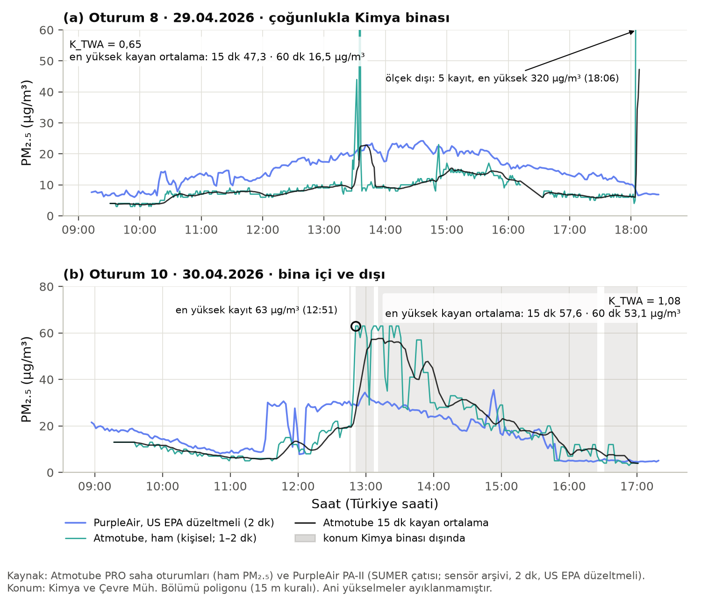

**Şekil 8.** İki oturumun zaman serisi: (a) Oturum 8 (çoğunlukla Kimya binası), (b) Oturum 10 (bina içi ve dışı). Yeşil: Atmotube
ham (1–2 dk), siyah: 15 dk kayan ortalama, mavi: eş zamanlı PurpleAir (US EPA, 2 dk); gri dilimler kişinin konumunun Kimya binası
dışında olduğu süreler. Birim µg/m³; Türkiye saati.

**Atmotube canlı kayıtları.** 15 Haziran – 12 Ekim'deki 416 kaydın 389'unda PM₂.₅ vardır; konumu kampüs içinde olan 299 kayıttan
233'ü PurpleAir'le eşleşmiştir (48 cihaz-gün; %83,7'si 09:00–16:59 arasında) [D.atp_*]. K ortancası 0,75'tir (çeyrekler arası
0,58–0,96; %10–90: 0,32–1,66); kayıtların %78,1'inde K < 1, %48,9'unda K < 0,75, %13,7'sinde K ≥ 1,25'tir [D.atp_K_*]. Nem hiçbir
eşleşen kayıtta %80'i aşmamıştır. Saha oturumlarındaki dağılım da benzerdir: Kimya binası noktalarında ortanca 0,65, bina dışı ve
diğer binalarda 0,82 (Şekil 9b). Bu dağılımlar, kampüste taşınan kişisel ölçerlerin zamanın çoğunda çatıdaki dış ortamdan daha temiz
havada bulunduğunu, yani zamanın çoğunun iç ortamda geçtiğini göstermektedir; oran, uygulamanın kapalı pencere (0,5) ile açık
pencere (0,8) katsayıları arasında yer almaktadır.

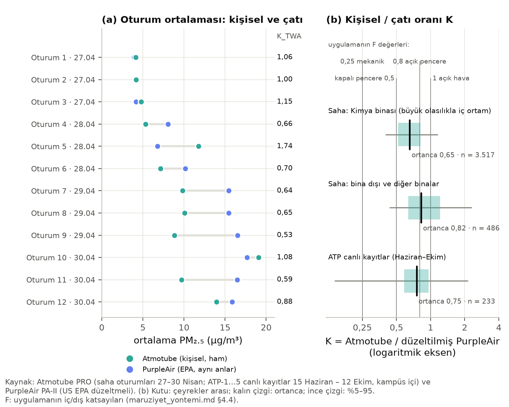

**Şekil 9.** (a) Oturum başına kişisel TWA (yeşil) ve aynı anlardaki çatı değeri (mavi), sağda K_TWA; (b) kişisel / çatı oranı K
(logaritmik eksen; kutu: çeyrekler arası, kalın çizgi: ortanca, ince çizgi: %5–95) ve uygulamanın F değerleri. Kaynak: Atmotube PRO
(saha oturumları 27–30 Nisan; ATP-1…5 canlı kayıtları 15 Haziran – 12 Ekim, kampüs içi) ve PurpleAir PA-II (US EPA düzeltmeli).

### 3.4 En kötü durum

**Tablo 5.** Sabit sensörde her tam günün en yüksek kayan ortalamasının günler arası dağılımı (154 tam gün; µg/m³).

| Pencere | Ortanca | %95'lik | En yüksek (bitiş zamanı) | ≥ 35,5 µg/m³ olan gün | ≥ 55,5 µg/m³ olan gün |
|---|---|---|---|---|---|
| 15 dk, tüm gün | 21,9 | 55,8 | 111,9 (19 Temmuz 19:43) | 21 | 8 |
| 60 dk, tüm gün | 20,1 | 44,4 | 83,7 (11 Ekim 22:41) | 14 | 5 |
| 15 dk, kampüs saatleri (08–18) | 17,5 | 36,0 | 102,7 (10 Mayıs 17:37) | 11 | 2 |
| 60 dk, kampüs saatleri (08–18) | 16,1 | 34,0 | 58,2 (12 Ekim 09:09) | 6 | 1 |

Kaynak: [E.m15_*, E.m60_*, E.k15_*, E.k60_*]. Eşikler HKİ "Hassas" ve "Sağlıksız" aralıklarının başıdır (gösterge).

Tipik bir günde günün en kötü saati günlük ortalamanın 1,69 katıdır; kampüs saatlerinde bu oran 1,31'dir [E.tepe_ortalama_orani,
E.tepe_ortalama_orani_kampus]. Günlerin %70,8'inde günün en kötü 60 dakikası kampüs saatleri dışında kalmış, bu pencerelerin %59,7'si
01:00–10:59 arasında bitmiş, en sık 07:00–08:00 arasında bitmiştir [E.kampus_disi_tepe_payi, E.m60_saat_01_10_payi, E.m60_saat_mod].
Kampüs saatlerindeki en kötü 60 dakika en sık sabah tepesinin kuyruğuna denk gelmektedir: günlerin %35,1'inde bu pencere 09:00–09:59 arasında, yani 08:00–10:00 diliminde bitmektedir [E.k60_bitis_09_payi]. Üç günde iki dakikalık düzeltilmiş
değer 100 µg/m³'ü aşan çok kısa olaylar görülmüştür: 10 Mayıs (Pazar; 2 dk 228,0, 15 dk 102,7 µg/m³), 19 Temmuz (Pazar; 238,2 ve
111,9 µg/m³) ve 28 Temmuz (125,7 ve 82,4 µg/m³) [E.kisa_olaylar]. Bu olaylar 60 dakikalık ortalamada belirgin biçimde sönümlenmektedir
(41–51 µg/m³); sensöre yakın, kısa süreli bir yanma kaynağını (ör. mangal ya da atık yakma) düşündürmektedir, ancak doğrulanmamıştır
ve ayıklanmamıştır.

**Kişisel sensörler.** Saha oturumlarının en kötü 15 dakikası ortanca 25,6 µg/m³ (en yüksek 87,6), en kötü 60 dakikası ortanca
14,2 µg/m³'tür (en yüksek 53,1) [E.kisisel_*]. Kişisel tepeler kısa pencerelerde çatı sensörününkilerden daha yüksek olabilmektedir;
bu, kişinin kaynaklara (sigara dumanı, araç, mutfak) daha yakın olabilmesiyle uyumludur. Atmotube ham değerleri mutlak düzeyde
PurpleAir ile doğrudan karşılaştırılamaz ve kısa sürelerde belirsizlikleri büyüktür (15 dakikalık çözünürlükte referans uyumu
R² ≈ 0,5; Shittu vd., 2025).

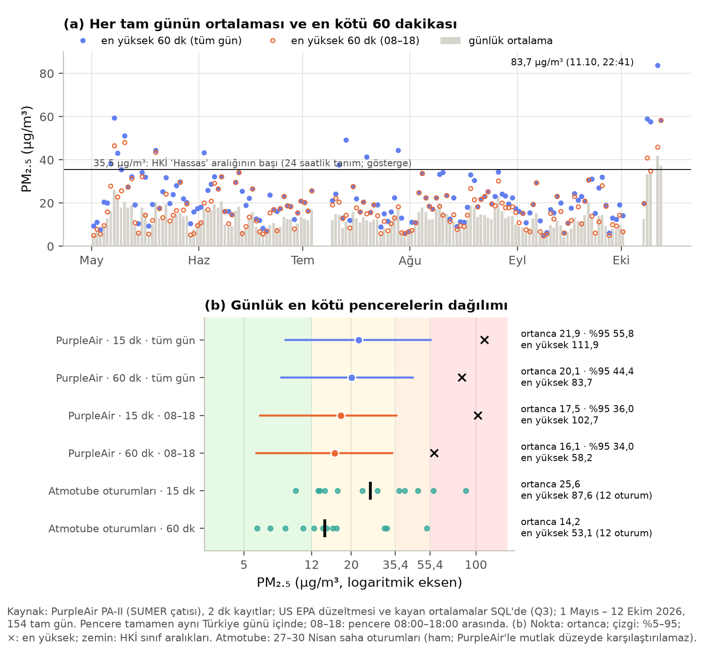

**Şekil 10.** (a) Her tam günün ortalaması (gri çubuk), en yüksek 60 dakikalık kayan ortalaması (dolu mavi) ve kampüs saatlerindeki
en yüksek 60 dakikası (boş turuncu); (b) günlük en kötü pencerelerin dağılımı (nokta: ortanca; çizgi: %5–95; ×: en yüksek; zemin: HKİ
aralıkları) ve saha oturumlarının tepeleri. Kaynak: PurpleAir PA-II, 2 dk kayıtlar, US EPA düzeltmesi ve pencereler SQL'de (Q3);
1 Mayıs – 12 Ekim 2026, 154 tam gün; Atmotube 27–30 Nisan (ham).

### 3.5 Senaryolar: kampüste geçen zaman dış ortamda geçseydi

**Tablo 6.** Gerçekçi ve tamamen dış ortam senaryoları (09:00–17:00, 8 saat; R = 1).

| Gün | Gerçekçi TWA (µg/m³) | Dış ortam TWA (µg/m³) | Dış/İç (TWA) | Gerçekçi D (µg) | Dış ortam D (µg) | Dış/İç (D) | Yürüyüş saatinin D payı |
|---|---|---|---|---|---|---|---|
| En temiz gün (23 Eylül) | 2,0 | 3,5 | 1,74 | 9,6 | 12,6 | 1,31 | %69 |
| Tipik gün (5 Mayıs) | 7,0 | 12,3 | 1,75 | 32,4 | 43,0 | 1,33 | %67 |
| En kötü gün (12 Ekim) | 18,4 | 33,2 | 1,80 | 75,3 | 104,9 | 1,39 | %61 |
| 107 günün ortancası (aralık) | 7,0 (2,0–18,4) | 12,3 (3,5–33,2) | 1,78 (1,69–1,85) | 28,8 (7,9–75,3) | 39,9 (11,1–104,9) | 1,36 (1,26–1,49) | %64 (%51–74) |
| Uygulamanın profili (tüm günlerin saat ortalaması) | 6,8 | 12,0 | 1,77 | 29,7 | 40,2 | 1,35 | — |

Kaynak: [F.en_temiz, F.tipik_gün, F.en_kötü, F.dagilim_*, F.uygulama_profili].

Kampüste geçen 8 saatin tamamı dış ortamda geçseydi zaman ağırlıklı maruziyet bütün günlerde yaklaşık 1,7–1,9 kat artardı. Bu oran
neredeyse sabittir, çünkü ağırlıklı ortalama F değeri (7 saat × 0,5 + 1 saat × 1) / 8 = 0,56'dır ve 1/0,56 ≈ 1,78'dir; günler
arasındaki küçük farklar saatlik profilin şeklinden gelir. Solunan miktardaki artış ise daha küçüktür (1,26–1,49 kat), çünkü iç
ortamdaki 7 saat düşük solunum hızıyla (oturma) geçerken en yüksek solunum hızlı saat (yürüme) iki senaryoda da açık havadadır.
Gerçekçi senaryoda solunan miktarın %51–74'ü bu tek açık hava saatinden gelmektedir.

**Duyarlılık (tipik gün).** Kapalı pencere katsayısı 0,3–0,75 aralığında değiştiğinde gerçekçi senaryonun solunan miktarı 28,1–37,7 µg,
mekanik havalandırmada (0,25) 27,1 µg, açık pencerede (0,8) 38,7 µg, bu çalışmada Kimya binasında ölçülen oranla (0,65) 35,5 µg'dır;
tamamen dış ortam senaryosu 43,0 µg'dır. Solunum hızlarının 95. yüzdelikleriyle gerçekçi senaryo 48,4 µg, dış ortam 64,9 µg olur
[F.duyarlilik_*]. Dış/İç oranı solunan miktarda 1,11 (açık pencere) ile 1,59 (mekanik havalandırma) arasında değişmektedir.

**Açık hava saatinin seçimi.** Hafta içi 107 günde 06:00–09:00 penceresinin ortancası 14,7 µg/m³, 16:00–19:00 penceresinin
ortancası 9,0 µg/m³'tür; günlerin %84,1'inde sabah penceresi daha yüksektir ve günlük oranın ortancası 1,5'tir [F.sabah_ortanca,
F.aksam_ortanca, F.sabah_kotu_gun_payi, F.sabah_aksam_oran_ortanca]. Tipik düzeyde 1 saatlik tempolu yürüyüşte sabah 22,9 µg,
akşamüstü 14,1 µg; 1 saatlik sporda 44,1 ve 27,1 µg PM₂.₅ solunmaktadır [F.yuruyus_1sa_*, F.spor_1sa_*].

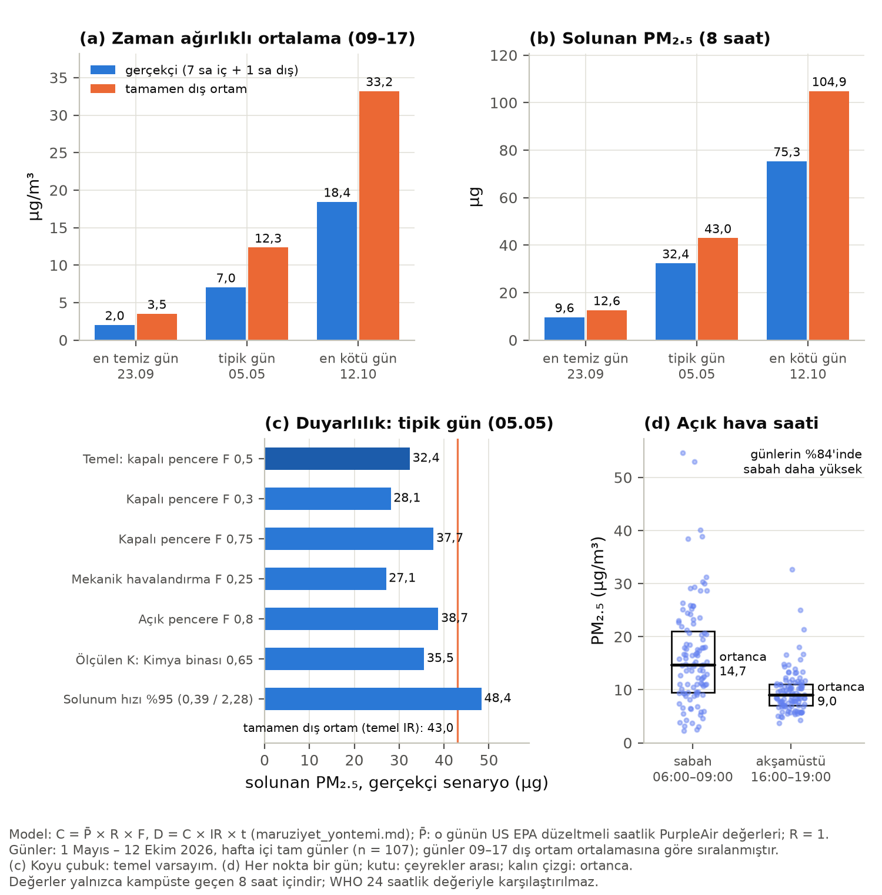

**Şekil 11.** (a) Zaman ağırlıklı ortalama ve (b) solunan PM₂.₅: gerçekçi (mavi) ve tamamen dış ortam (turuncu) senaryoları, en
temiz, tipik ve en kötü günde; (c) tipik günde F ve IR varsayımlarına duyarlılık (dikey çizgi: tamamen dış ortam); (d) sabah
(06–09) ve akşamüstü (16–19) pencere ortalamaları, her nokta bir gün. Kaynak: PurpleAir PA-II, US EPA düzeltmeli saatlik değerler;
1 Mayıs – 12 Ekim 2026, 107 hafta içi tam gün; model `docs/maruziyet_yontemi.md`. Değerler yalnızca kampüste geçen süre içindir.

### 3.6 İç ortam göstergesi (CO₂)

İç ortam CO₂ verisi 22 Haziran 14:30 – 21 Temmuz 16:52 arasında 19 güne yayılan 2.814 kayıttan oluşmaktadır. Yalnızca ilk yarım
saatteki 16 kayıt değişken değer taşımaktadır (450–753 ppm); 22 Haziran 15:01'den sonraki 2.798 kaydın tamamı aynı değer üçlüsünü
(400 ppm, 27,2 °C, %49 bağıl nem) yinelemektedir ve 2.804 kayıt bir önceki kayıtla birebir aynıdır [G.co2_*]. Haftalar boyunca hiç
değişmeyen sıcaklık ve nem gerçek bir ölçümle bağdaşmadığından bu kayıtlar, cihaz çevrimdışıyken toplayıcının bulut hizmetinin
döndürdüğü son değeri her sorguda yeni zaman damgasıyla yazmasından kaynaklanıyor olmalıdır (`backend/tuya_co2.py` her kayda o anın
saatini yazar; PurpleAir'deki "aynı son ölçümü yazma" denetiminin karşılığı yoktur). Bu nedenle saatlere göre CO₂ dağılımı ve
1000 ppm üstü süre payı hesaplanamamıştır; 1000 ppm'i aşan kayıt bulunmaması (0) bir ölçüm sonucu değildir (Şekil 1).

Nitel olarak: kalabalık ve az havalandırılan bir sınıfta CO₂'nin yükselmesi hava değişim hızının düşük olduğunu gösterir. Düşük
hava değişimi dış ortam PM₂.₅'inin içeri geçişini azaltır (F küçülür), ancak tozun yeniden havalanması gibi iç kaynakların biriktiği
durumlarda iç ortam düzeyi dış ortamı aşabilir (Chen ve Zhao, 2011). Uygulamanın modeli iç kaynakları içermediğinden, geçerli CO₂
verisi elde edildiğinde F varsayımının hangi saatlerde iyimser kaldığı bu ilişki üzerinden tartışılabilir.

---

## 4 Tartışma

**Zamansal desen.** Kampüste PM₂.₅'in gece birikip sabah 05:00–08:00 arasında en yüksek düzeye ulaşması ve akşamüstü en düşük
düzeye inmesi her ayda yinelenmektedir. Bu desen, gece ve sabah saatlerindeki sığ ve kararlı karışım katmanında birikmenin, gündüz
karışım katmanının derinleşmesiyle seyrelmenin beklenen sonucudur (Seinfeld ve Pandis, 2016). Hafta içi gündüz değerlerinin hafta
sonundan yaklaşık 2 µg/m³ yüksek olması yerel etkinliğin (trafik, kampüs içi hareket) katkısını düşündürmektedir; sabah tepesinin
hafta sonu da sürmesi ise bu tepenin büyük ölçüde meteorolojik birikmeyle ve bölgesel kaynaklarla ilişkili olduğunu
göstermektedir. Ekim epizodu çok günlü ve gece ağırlıklıdır; bu, bölgesel ölçekte bir olayla uyumludur, ancak bu raporda nedeni
(ör. taşınım, durgun hava) ayrıca incelenmemiştir. Nemle ilişkinin büyük ölçüde ortak günlük döngüden geldiği ve dönemde %75'i aşan
nemin çok seyrek olduğu dikkate alındığında, sabah tepesinin bir ölçüm yapıtı olma olasılığı düşüktür.

**Mekânsal bulgular.** Saha verisi "kampüsün neresi kötü?" sorusuna şimdilik ancak dar bir alan için yanıt verebilmektedir. Bu alanda
en açık bulgu, aynı kişilerin bina içindeki maruziyetinin çatıdaki dış ortam düzeyinin yaklaşık üçte ikisi, Güzide Kafe çevresi ve
yürüyüş hattında ise dış ortam düzeyinde olmasıdır. Göreli indeks G, oturum ortancası iç ortam ağırlıklı olduğundan iç–dış farkını da
içerir; mekânsal bir sıcak noktadan söz edebilmek için çatı düzeyinin de üstünde kalan (K ≥ 1,25) ve birden çok oturumda yinelenen
yerler gerekir. Bu ölçütü yalnızca Güzide Kafe'deki bir hücre (H1) karşılamaktadır ve bulgu ön niteliktedir. Mobil ölçümle güvenilir
bir mekânsal harita için aynı güzergâh parçalarının çok sayıda tekrarlanması gerektiği bilinmektedir (Van den Bossche vd., 2015).

**Kişisel maruziyet ve model.** Kimya binasında ölçülen kişisel/çatı oranının (0,53–0,88; ortanca yaklaşık 0,65) ve canlı kayıtlarda
bulunan oranın (ortanca 0,75) uygulamanın kapalı pencere (0,5) ve açık pencere (0,8) katsayıları arasında kalması, modeldeki F
aralığının bu bina için makul olduğunu düşündürmektedir; sızma katsayısı için literatürde bildirilen değerlerle de uyumludur
(Chen ve Zhao, 2011; Hänninen vd., 2011). Bununla birlikte oranın mutlak düzeyi, Atmotube ile düzeltilmiş PurpleAir'in yerel olarak
yan yana ölçülmemiş olmasına bağlı bir belirsizlik taşır. Kişisel tepeler (tek kayıtta 500 µg/m³'ü aşan değerler) çatı sensöründe
görülmeyen, kaynağa yakınlıkla ilgili kısa süreli maruziyetlerdir; toplam solunan miktara katkıları bazı oturumlarda belirgindir.

**En kötü durum.** Çatı sensörünün en kötü saatleri çoğunlukla insanların kampüste bulunmadığı gece ve sabah erken saatlerindedir;
kampüs saatlerinde günün en kötü saatinin ortancası 16,1 µg/m³'tür. Kampüse sabah erken gelenler (07:00–09:00) ise günün en kirli
dilimlerinden birinde açık havada yürümektedir.

**Senaryolar.** "Tamamen dış ortam" senaryosu zaman ağırlıklı maruziyeti yaklaşık 1,8 kat artırırken solunan miktarı yaklaşık 1,4 kat
artırmaktadır. Gerçekçi bir günde solunan miktarın çoğunu kısa süreli ama yüksek solunum hızlı açık hava etkinliği belirlediğinden,
en etkili kişisel önlem bu etkinliğin zamanlamasıdır: sabah yerine akşamüstü yapılan bir saatlik yürüyüş ya da spor, tipik günde
yaklaşık %40 daha az PM₂.₅ solunması anlamına gelmektedir. Uygulamanın tüm günler profiliyle hesaplanan değerlerin (6,8 ve 12,0 µg/m³)
günlük hesapların ortancasına (7,0 ve 12,3 µg/m³) çok yakın olması, uygulamadaki asistanın tipik bir günü iyi temsil ettiğini, ancak
epizot günlerindeki 2–3 kat yüksek değerleri göstermediğini düşündürmektedir.

## 5 Sınırlılıklar

1. **Düzeltme ve temsil:** PurpleAir'in US EPA düzeltmesi Türkiye'de resmî bir cihaz yanında doğrulanmamıştır; toz olaylarında düşük
   tahmin edebilir. Sensör tek noktadadır ve çatı yüksekliğindedir; solunum yüksekliğindeki ve başka bölgelerdeki düzeyi temsil
   etmeyebilir.
2. **Dönem:** Veri Mayıs–Ekim aylarını kapsar; kış (ısınma dönemi) yoktur. 4–8 Temmuz ve 2–6 Ekim kesintileri vardır; 8–12 Ekim
   epizodu analiz kesildiğinde sürmekteydi.
3. **Meteoroloji:** Arşiv döneminde PurpleAir sıcaklığı ve PM₁₀ kaydı büyük ölçüde yoktur; rüzgâr verisi yoktur. Nem gövde içi
   ölçümdür ve ortamdan birkaç puan düşük okur.
4. **Saha verisi:** Dört bahar günü, üç ekip ve 12 oturumla sınırlıdır; noktaların %87,8'i tek binadadır; iç/dış ortam ayrımı
   ölçülmemiş, bina poligonuna ve kişisel/çatı oranına göre çıkarsanmıştır; GPS bina içinde sapabilir. Oturumların hangi Atmotube
   cihazıyla ölçüldüğü bilinmemektedir (veritabanında hepsi "cihaz 1"); cihazlar arası farklar ekip karşılaştırmalarını etkileyebilir.
   Atmotube'un 1 µg/m³ çözünürlüğü düşük düzeylerde oranları kabalaştırır.
5. **Atmotube kalibrasyonu:** Yan yana ölçüm tamamlanmadığı için K'nin mutlak düzeyi belirsizdir; literatürde Atmotube PRO'nun dakikalık
   değişim katsayısı %28, 15 dakikalık referans uyumu R² ≈ 0,5 olarak bildirilmiştir (Shittu vd., 2025). Atmotube değerleri WHO ile
   mutlak karşılaştırılmamıştır.
6. **İstatistik:** Birimlerin çoğu 2–7 oturuma dayandığından bootstrap güven aralıkları kaba ve kararsızdır; sıcak nokta eşiği (1,25)
   bu çalışmanın kuralıdır.
7. **Canlı kayıtlar:** 233 eşleşen kayıt seyrek ve anlıktır; cihazın çanta ya da cep içinde olup olmadığı bilinmemektedir. İzin
   sistemi kampüs içi koordinatların sorgulanmasını onaylamadığı için canlı kayıtların konumu (bina içi/dışı) kullanılmamıştır.
8. **Senaryo modeli:** R = 1 alınmıştır; F literatür değerleridir, iç kaynaklar ve bina farkları dahil değildir; solunum hızları
   yetişkin ortalamalarıdır. Yalnızca hafta içi günler alınmış, resmî tatiller ayrılmamıştır. Sonuçlar kampüste geçen 8 saat içindir;
   WHO 24 saatlik değeriyle karşılaştırılmamıştır.
9. **CO₂:** Verinin tamamına yakını donmuş değerdir; iç ortam sorusu yanıtlanamamıştır.

## 6 Sonuç ve öneriler

**Soru 1 (nerede, nasıl, ne zaman):** Kampüste PM₂.₅ en çok gece ve sabah saatlerinde (03:00–10:00, tepe 06:00–08:00) ve çok günlü
epizotlarda (8–12 Ekim) yükselmektedir; akşamüstü (16:00–19:00) en temiz dilimdir. Mekânsal olarak mevcut veriyle yalnızca Kimya binası –
SUMER – Güzide Kafe – Kütüphane hattı değerlendirilebilmiştir: bu hatta bina içi maruziyet dış ortamın altında, Güzide Kafe çevresi ve
yürüyüş yolları dış ortam düzeyindedir; Güzide Kafe'deki bir 25 m hücrede çatı düzeyinin yaklaşık %36 üstünde değerler, doğrulanması
gereken yerel bir kaynağı düşündürmektedir. Kampüsün geri kalanı için sıcak nokta haritası çıkarmak bu veriyle mümkün değildir.

**Soru 2 (en kötü durum):** Çatı sensöründe günün en kötü 60 dakikası tipik olarak 20,1 µg/m³ (her 20 günden birinde 44,4 µg/m³'ün
üstünde; en yüksek 83,7 µg/m³), kampüs saatlerinde 16,1 µg/m³'tür (en yüksek 58,2). Kişisel ölçümlerde en kötü 60 dakika 53,1, en kötü
15 dakika 87,6 µg/m³ ve tek kayıt 522 µg/m³'e ulaşmıştır.

**Soru 3 (tamamen dış ortam):** Tipik bir günde kampüste geçen 8 saatin zaman ağırlıklı maruziyeti 7,0 yerine 12,3 µg/m³ (1,75 kat),
solunan miktar 32,4 yerine 43,0 µg (1,33 kat) olurdu; 107 günde bu katlar sırasıyla 1,69–1,85 ve 1,26–1,49'dur. Ölçülen kişisel/çatı
oranları (Kimya binasında yaklaşık 0,65, canlı kayıtlarda 0,75) bu senaryodaki iç ortam varsayımını destekler niteliktedir.

**Öneriler** (ölçülü; karar kullanıcınındır):

1. **Kişisel:** Açık havada spor ve uzun yürüyüşlerin sabah erken saatler yerine akşamüstüne alınması önerilir; iç mekânların dış
   havanın daha temiz olduğu akşamüstü havalandırılması, sabah tepesi ve epizot günlerinde pencerelerin kapalı tutulması düşünülebilir.
2. **Saha ölçüm tasarımı:** Kampüsü kapsayan sabit güzergâhların farklı gün ve saatlerde tekrar tekrar yürünmesi, uygulamada her
   ölçüm dilimine iç/dış ortam etiketi eklenmesi ve oturum başına hangi Atmotube cihazının kullanıldığının kaydedilmesi önerilir.
   Böylece G yerine doğrudan dış ortam sıcak noktaları (K) haritalanabilir.
3. **Atmotube yan yana ölçümü** tamamlandığında K oranları cihaz çarpanıyla yeniden hesaplanmalıdır.
4. **CO₂ toplayıcısı:** `backend/tuya_co2.py`'nin cihazın çevrimiçi durumunu ya da güncelleme zamanını denetlemesi ve aynı son
   değeri yeniden yazmaması önerilir; 22 Haziran 15:01 – 21 Temmuz arasındaki kayıtların "donmuş" diye işaretlenmesi (silinmeden)
   kullanıcı onayıyla değerlendirilebilir. Tuya planı yenilendiğinde iç ortam analizi tekrarlanabilir.
5. **Uygulamanın maruziyet modeli için öneriler** (uygulama değiştirilmedi): P profilinin aya göre ayrılması (Ekim profili diğer
   aylardan belirgin farklıdır); ölçülen K değerinin (Kimya binası 0,65) bina özelinde F için bir dayanak olarak belgelenmesi;
   asistanın F ve IR aralıklarına göre bir sonuç aralığı göstermesi.

---

## Kaynakça

Doğrulama durumu: "uygulama belgesi" = künye ve değerler `docs/` belgelerinde kayıtlı olup bu çalışmada yeniden açılmamıştır;
"arama özeti" = künye bu çalışmada web arama sonuçları ve katalog kayıtlarıyla denetlenmiş, tam metin açılamamıştır
(Crossref ve yayıncı sitelerine bu ortamdan erişilemedi).

- Afroz, R., Alonzo, J., Omar, S., Cheng, C., Schneider, S., Zhao, R. (2025). Impact of wildfire smoke PM2.5 on indoor air quality
  of public buildings on a university campus. *ACS ES&T Air*, 2, 625–636. https://doi.org/10.1021/acsestair.4c00342 — uygulama belgesi.
- ASHRAE (2022; 2025'te güncellendi). *ASHRAE Position Document on Indoor Carbon Dioxide*. Atlanta: ASHRAE; ASHRAE Technical FAQ
  (TC 4.3) — arama özeti (standartlarda CO₂ sınırı olmadığı; 1000–1200 ppm'in koku kabulüyle ilişkisi).
- Barkjohn, K. K., Gantt, B., Clements, A. L. (2021). Development and application of a United States-wide correction for PM2.5 data
  collected with the PurpleAir sensor. *Atmospheric Measurement Techniques*, 14, 4617–4637. https://doi.org/10.5194/amt-14-4617-2021
  — uygulama belgesi (katsayılar ikincil).
- Chen, C., Zhao, B. (2011). Review of relationship between indoor and outdoor particles: I/O ratio, infiltration factor and
  penetration factor. *Atmospheric Environment*, 45, 275–288. https://doi.org/10.1016/j.atmosenv.2010.09.048 — uygulama belgesi.
- Field, C. A., Welsh, A. H. (2007). Bootstrapping clustered data. *Journal of the Royal Statistical Society: Series B*, 69(3),
  369–390. https://doi.org/10.1111/j.1467-9868.2007.00593.x — arama özeti (küme bootstrap'ın iki model altında da tutarlı olduğu).
- Hänninen, O. ve ark. (2011). Seasonal patterns of outdoor PM infiltration into indoor environments. *Air Quality, Atmosphere &
  Health*, 4, 221–233. https://doi.org/10.1007/s11869-010-0076-5 — uygulama belgesi.
- Jayaratne, R., Liu, X., Thai, P., Dunbabin, M., Morawska, L. (2018). The influence of humidity on the performance of a low-cost
  air particle mass sensor and the effect of atmospheric fog. *Atmospheric Measurement Techniques*, 11, 4883–4890.
  https://doi.org/10.5194/amt-11-4883-2018 — arama özeti (yaklaşık %75 nemin üstünde belirgin artış).
- Klepeis, N. E. ve ark. (2001). The National Human Activity Pattern Survey (NHAPS): a resource for assessing exposure to
  environmental pollutants. *Journal of Exposure Analysis and Environmental Epidemiology*, 11(3), 231–252.
  https://doi.org/10.1038/sj.jea.7500165 — arama özeti (EPA HERO kaydı; zamanın yaklaşık %87'si kapalı binalarda).
- Salamalikis, V. ve ark. (2025). Citizen-operated low-cost sensors for estimating outdoor particulate matter infiltration.
  *Air Quality, Atmosphere & Health*, 18, 2609–2624. https://doi.org/10.1007/s11869-025-01787-4 — uygulama belgesi.
- Seinfeld, J. H., Pandis, S. N. (2016). *Atmospheric Chemistry and Physics: From Air Pollution to Climate Change* (3. baskı).
  Hoboken: Wiley. ISBN 978-1-118-94740-1 — arama özeti (künye); içerik genel ders kitabı bilgisi olarak kullanılmıştır.
- Shittu, A. I. ve ark. (2025). Performance evaluation of Atmotube PRO sensors for air quality measurements in an urban location.
  *Atmospheric Measurement Techniques*, 18, 817–828. https://doi.org/10.5194/amt-18-817-2025 — arama özeti (8 cihaz, 14 hafta, Fidas;
  saatlik R² > 0,7, 15 dk R² 0,48–0,53, dakikalık değişim katsayısı %28, nem > %80'de pozitif sapma). Uygulama belgesindeki eğim
  (0,99) bu çalışmada doğrulanmamıştır.
- U.S. EPA (2011). *Exposure Factors Handbook: 2011 Edition*, Bölüm 6, Tablo 6-2 (EPA/600/R-09/052F) — uygulama belgesi (3 Ekim 2026'da
  doğrulanmış).
- Van den Bossche, J., Peters, J., Verwaeren, J., Botteldooren, D., Theunis, J., De Baets, B. (2015). Mobile monitoring for mapping
  spatial variation in urban air quality: development and validation of a methodology based on an extensive dataset.
  *Atmospheric Environment* — arama özeti (yazarlar ve bulgular); cilt ve sayfa (105, 148–161) doğrulanmamıştır.
- WHO (2021). *WHO global air quality guidelines.* Cenevre: WHO. ISBN 978-92-4-003422-8 — uygulama belgesi.
- İBB Çevre Koruma ve Kontrol Dairesi Başkanlığı. Hava Kalitesi İndeksi (HKİ kesim noktaları) — uygulama belgesi.

---

## Ek A · Yeniden üretim

- **Sorgular:** `betikler/sorgular.sql` (Supabase `wgirpaysokuoygycmdst`, yalnızca SELECT): Q1 PurpleAir saatlik (sunucunun saatlik
  toplamasıyla aynı), Q2 saha noktaları (oturum adı yerine ad ön ekinin md5 özetinin 8 karakteri; betik bunu `app.js` → `PEOPLE` ile
  "Saha ekibi A/B/C"ye çevirir), Q3 günlük kayan ortalama tepeleri (düzeltme ve pencereler SQL'de), Atmotube canlı kayıtlarının
  eş zamanlı PurpleAir değeri (koordinatsız) ve CO₂ kayıtları. Çıktılar olduğu gibi `Q1.txt`, `Q2.txt`, `Q3.txt` olarak bir klasöre
  kaydedilir (bu klasör depoya konmaz; saha noktaları konum içerir).
- **Ek girdiler (depoda):** `docs/veri/purpleair_229263_2dk_2026-04-27_2026-10-06.csv` (27–30 Nisan eşleştirmesi),
  `frontend_v2/data/campus.geojson`, `frontend_v2/js/app.js` (`PEOPLE`), `colorscale.js` ve `maruziyet.js` (sabitlerin denetimi).
- **Çalıştırma:** `python3 -I -B betikler/hepsi.py <ham klasörü> <rapor klasörü>` — Şekil 1–11'i ve `sayilar.json`'u baştan üretir
  (yaklaşık 11 sn). Tek tek: `a_envanter.py` (Şekil 1, A.* ve G.*), `b_zaman.py` (Şekil 2–5, B.*), `c_mekan.py` (Şekil 6–7, C.*),
  `d_kisisel.py` (Şekil 8–9, D.*), `e_en_kotu.py` (Şekil 10, E.*), `f_senaryo.py` (Şekil 11, F.*). Betikler başta uygulamanın
  düzeltme katsayılarını, HKİ eşiklerini, F/IR değerlerini ve 15 m kuralını kaynak dosyalarla karşılaştırır; fark varsa durur.
- **Bağımsız sayı denetimi (Ajan 1, 13 Ekim 2026):** tam gün sayısı ve ortalama, günlük döngü, en kötü %5 eşiği, 8–12 Ekim epizodu, günlük en kötü 60 dakika, Kimya binası payı, tipik gün senaryosu ve CO₂ donma bulgusu ayrı betiklerle yeniden hesaplanmış, sekizi de tutmuştur.
- **Yapılan denetimler:** Python düzeltmesi uygulamanın `paCorrect` ve `hki` işlevleriyle (Node.js) 418 saat ve 17 sınır değerinde
  birebir aynıdır; SQL kayan ortalama tepeleri sensör arşivinden bağımsız hesaplamayla 152 günde en çok 0,03 µg/m³ farklıdır;
  Ajan 1'in Mayıs–Eylül sayıları (148 tam gün, 12,1 µg/m³, 38 aşım günü, aylık 13,4 / 12,1 / 11,2 / 13,9 / 9,8; 06:00'da 15,8,
  18:00'de 8,9 µg/m³) aynen yeniden elde edilmiştir.
- **KVKK:** Çıktılarda kişi adı, oturum adı ve kampüs dışı konum yoktur; haritada yalnızca en az 2 oturum ve 10 ölçüm içeren hücreler
  çizilmiştir. Şekil 8 ve Tablo 4'te oturumlar kişi ya da ekip etiketi olmadan, yalnızca numarayla verilmiştir.
